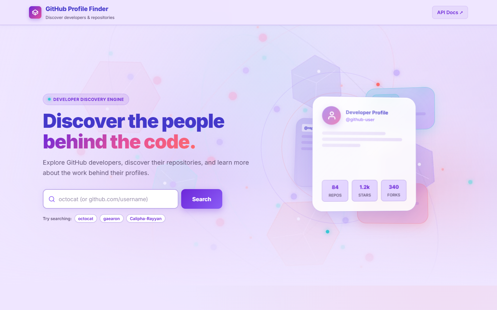
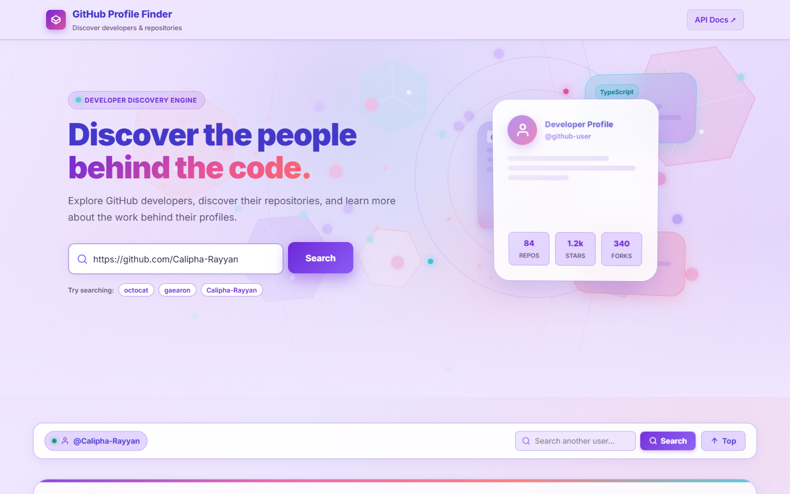
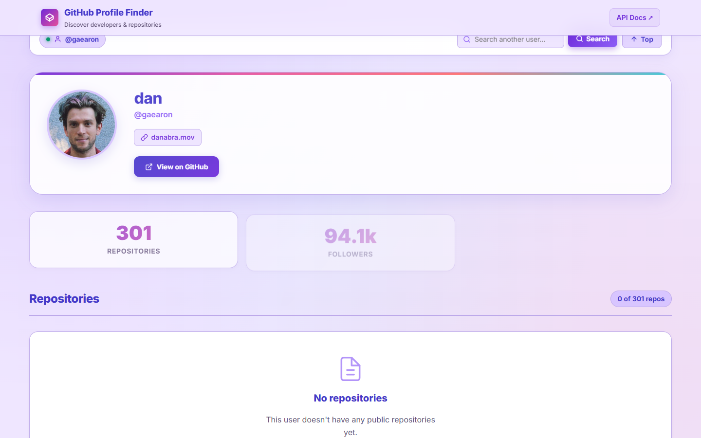
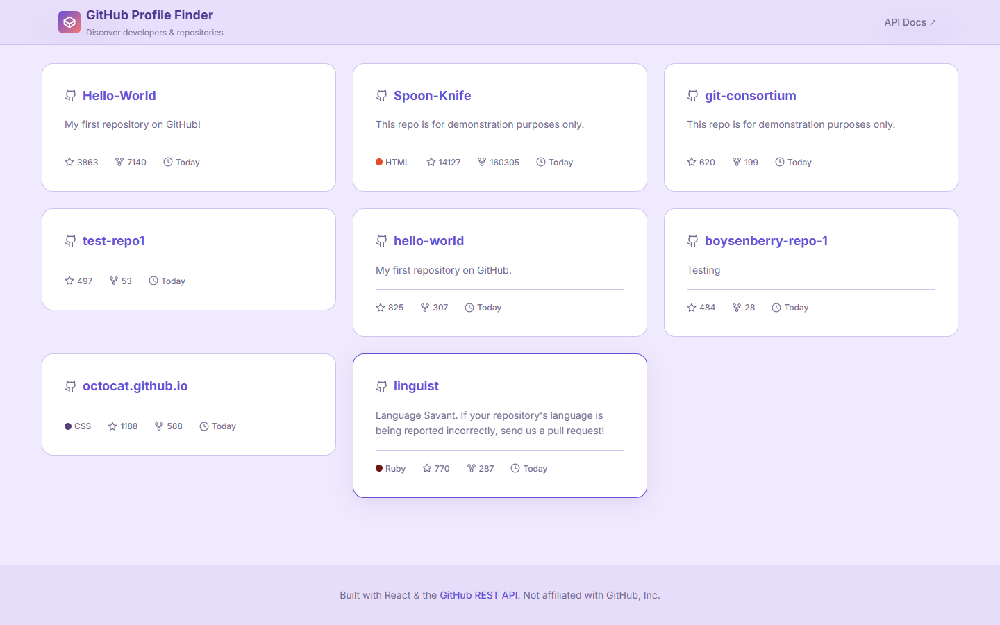

# GitHub Profile Finder

> **Discover the people behind the code.**  
> A polished, responsive, and accessible GitHub discovery application built with **React**, **Vite**, modern **CSS**, and the **GitHub REST API**. Featuring a custom **Lavender Prism** visual identity, pointer-responsive interactive 3D hero scene, and an original looping abstract background video.

---

## 📸 Screenshots

| Vibrant Desktop Hero & 3D Prism | Results Toolbar & Profile View |
|:---:|:---:|
|  |  |

| Multi-User Discovery (`@gaearon`) | Repository Discovery Grid |
|:---:|:---:|
|  |  |

---

## ✨ Features

- **Live GitHub REST API Integration:** Direct client-side integration querying public user profiles and repositories via native browser `fetch`.
- **Enhanced Results Toolbar:** Seamless multi-user exploration. Once results appear, a persistent toolbar provides an active profile badge, an inline search input with instant submission, and a quick "Top" scroll button—eliminating the need to manually scroll back to the hero to search another developer.
- **Smart URL & Handle Sanitization:** Automatically parses raw usernames, `@username` tags, and complete profile URLs (e.g., `https://github.com/Calipha-Rayyan`) down to clean identifiers.
- **Interactive 3D Spatial Hero:** Multi-layered isometric prism composition built with CSS 3D perspective (`1200px`), depth-separated planes (`translateZ(0px)` to `-180px`), and cursor parallax tracking that responds across the entire hero section.
- **Vibrant Looping Video Background:** High-definition 8-second seamless looping abstract motion graphic (`public/videos/hero-bg.webm`, 1.75 MB) featuring glowing cyan, magenta, and coral particles and geometric prisms, with radial vignette framing for optimal contrast.
- **Quick-Discovery Suggestion Chips:** One-click sample profile buttons (`octocat`, `gaearon`, `Calipha-Rayyan`) for instant exploration.
- **Complete State Coverage:**
  - **Empty Input:** Pre-flight validation prevents unnecessary API consumption.
  - **Malformed Input:** Validates GitHub username regex patterns (1–39 alphanumeric and hyphen characters).
  - **Loading:** Non-blocking loading spinner with skeleton layout placeholders.
  - **404 Not Found:** Distinct card alerting when an account does not exist.
  - **403 Rate Limit vs. 403 Forbidden:** Correctly parses `X-RateLimit-Remaining` and `X-RateLimit-Reset` to compute human-readable countdowns, while distinctly identifying non-quota organizational blocks.
  - **Network Failure:** Connection error detection with a one-click Retry action.
  - **Zero Repositories:** Friendly empty state when a user has no public repositories.
  - **Partial Failure:** If repository loading fails, the profile and statistics remain visible while displaying a localized repository error with independent Retry.
  - **Race Condition Prevention:** Utilizes `AbortController` and search-identity checks to ensure in-flight searches are superseded cleanly when a new search starts.
- **Repository Exploration & Pagination:** Paginated grid display (12 items per page) with language color badges, star counts, fork counts, relative update timestamps, and a dynamic "Load More" button with duplicate prevention.
- **Responsive Layouts:** Custom fluid design tested across 360px, 375px, 768px, 1024px, and 1440px viewports with zero horizontal overflow.
- **Accessibility & Motion Compliance:** Full semantic HTML, visible keyboard focus indicators, ARIA roles, and total compliance with `prefers-reduced-motion: reduce`.

---

## 🎨 Design Direction — Lavender Prism (Enhanced)

A high-contrast visual system combining lavender, violet, coral, plum, and electric cyan.

| Token | Hex Value | Usage | Contrast Ratio (vs. Background) |
|---|---|---|:---:|
| **Background Light** | `#EFE6FF` | Page body & hero backdrops | — |
| **Surface Mid** | `#E3D5FF` | Card backgrounds & elevated areas | — |
| **Surface Strong** | `#D8C5FF` | Active cards & hover states | — |
| **Primary Violet** | `#6D28D9` | Primary action buttons & brand focus | **7.1:1** (WCAG AAA) |
| **Deep Indigo** | `#4438CA` | Heading gradients & dark badges | **8.5:1** (WCAG AAA) |
| **Electric Violet** | `#8B5CF6` | Glows, active borders & focus rings | — |
| **Coral Sunset** | `#FF6B6B` | Accents, gradients & live badges | — |
| **Magenta Flare** | `#E6509B` | Gradient transitions & taglines | — |
| **Prism Cyan** | `#35C7D4` | Accent dots, status indicators & borders | — |
| **Deep Plum Text** | `#33224D` | Primary headings & high-contrast text | **12.1:1** (WCAG AAA) |
| **Muted Violet Text** | `#625477` | Descriptions, metadata & timestamps | **5.4:1** (WCAG AA) |
| **Border Medium** | `#BDA9EA` | Defined card outlines & dividers | — |
| **Peach Highlight** | `#FFE0D8` | Warm ambient gradients & highlights | — |

*Typography:* **Inter** with native system fallbacks (`-apple-system`, `BlinkMacSystemFont`, `Segoe UI`, `Roboto`, `sans-serif`).

---

## 🛠 Tech Stack

- **Runtime & Build:** [Node.js](https://nodejs.org/) & [Vite](https://vitejs.dev/)
- **UI Framework:** [React 19](https://react.dev/)
- **Language:** JavaScript (ES2022)
- **Styling:** Vanilla CSS with custom properties, CSS Grid, Flexbox, and 3D transforms
- **Linter:** [Oxlint](https://oxc.rs/docs/guide/usage/linter.html)
- **API:** [GitHub REST API v3](https://docs.github.com/en/rest)
- **Automated Testing:** Puppeteer with headless Chrome

---

## 🔌 API Endpoints Used

| Endpoint | Method | Purpose |
|---|---|---|
| `https://api.github.com/users/{username}` | `GET` | Fetches user profile, display name, avatar, bio, location, company, blog, follower/following counts, and public repo counts. |
| `https://api.github.com/users/{username}/repos?sort=updated&per_page=12&page={n}` | `GET` | Fetches paginated public repositories sorted by most recently updated. |

*Rate Limits:* Unauthenticated requests are limited by GitHub to 60 queries/hour per IP. The application gracefully reports quota resets without breaking.

---

## 🚀 How to Run the Program

### Prerequisites

Ensure you have **Node.js** (v18 or higher) installed:

```bash
node -v
npm -v
```

### 1. Installation

Clone the repository and install dependencies:

```bash
git clone https://github.com/Calipha-Rayyan/GitHub-Profile-Finder.git
cd GitHub-Profile-Finder
npm install
```

### 2. Start Development Server

Run the local development server:

```bash
npm run dev
```

Open your browser and navigate to:
```
http://localhost:5173
```

### 3. Run Linter

To verify code syntax and style rules:

```bash
npm run lint
```

### 4. Build for Production

To create an optimized production build in the `dist/` folder:

```bash
npm run build
```

### 5. Preview Production Build

To preview the production build locally:

```bash
npm run preview
```

### 6. Run Automated QA Test Suite

To run the automated browser test suite verifying all 24 API, 3D, and accessibility scenarios:

```bash
node scripts/qa-runner.js
```

---

## 📁 Project Structure

```
GitHub-Profile-Finder/
├── index.html                   # HTML entry point with meta tags & favicon
├── package.json                 # Project dependencies & scripts
├── vite.config.js               # Vite bundler configuration
├── .gitignore                   # Ignored files (node_modules, dist, logs, etc.)
├── README.md                    # Project documentation
├── public/
│   ├── favicon.svg              # Custom application brand mark
│   ├── images/
│   │   ├── hero-poster.jpg      # Video fallback poster (53 KB)
│   │   └── hero-poster.svg      # Vector alternative graphic
│   └── videos/
│       └── hero-bg.webm         # Original 8s seamless looping abstract video (1.1 MB)
├── screenshots/                 # Captured QA screenshots across viewports
│   ├── 1-desktop-hero.png
│   ├── 2-empty-validation.png
│   ├── 3-user-not-found.png
│   ├── 4-profile-results.png
│   ├── 5-repo-grid.png
│   ├── responsive-mobile-375.png
│   └── responsive-tablet-768.png
├── scripts/
│   ├── generate-video.js        # Script that recorded the WebM background video
│   ├── verify-app.js            # General browser verification script
│   └── qa-runner.js             # Comprehensive 24-point automated test suite
└── src/
    ├── main.jsx                 # React root mount
    ├── App.jsx                  # Main orchestrator & state manager
    ├── components/
    │   ├── Navbar.jsx           # Sticky glassmorphic header
    │   ├── Hero.jsx             # 3D prism, video background & search container
    │   ├── SearchForm.jsx       # Input field with URL sanitization & validation
    │   ├── ResultsToolbar.jsx   # Results toolbar for quick re-search & active profile
    │   ├── ProfileCard.jsx      # Avatar, user metadata & external profile link
    │   ├── ProfileStats.jsx     # Repository, follower, and following counts
    │   ├── RepositoryGrid.jsx   # Grid list with pagination control
    │   ├── RepositoryCard.jsx   # Repository details, language pill & stats
    │   ├── LoadingState.jsx     # Spinner & animated skeleton shimmer
    │   ├── ErrorState.jsx       # Contextual alerts with dynamic retry
    │   └── EmptyState.jsx       # Zero-repository empty state
    ├── hooks/
    │   ├── usePointerTilt.js    # Smooth 3D perspective rotation with lerp damping
    │   ├── useReducedMotion.js  # Detects prefers-reduced-motion media query
    │   └── useScrollMotion.js   # Parallax scroll offset calculations
    ├── services/
    │   └── githubApi.js         # Fetch client, error parsing & rate limit header checks
    └── styles/
        ├── global.css           # Design tokens, resets, typography, and focus outlines
        ├── components.css       # Component styling, 3D spatial properties & keyframes
        └── responsive.css       # Mobile, tablet, laptop & desktop media queries
```

---

## ♿ Accessibility & Performance Notes

- **Keyboard Usability:** All interactive components (inputs, buttons, cards, links) are reachable via standard `Tab` / `Shift+Tab` sequence and display visible `focus-visible` outlines.
- **Screen Reader Support:** Semantic HTML elements (`<header>`, `<main>`, `<article>`, `<section>`, `<nav>`, `<footer>`) with descriptive `aria-label`, `aria-describedby`, and `role="alert"` / `role="status"` announcements for dynamic states.
- **Resource Conservation:**
  - Background video uses `muted`, `playsInline`, and automatically pauses when the element is offscreen (`IntersectionObserver`) or when the user switches browser tabs (`visibilitychange`).
  - When `prefers-reduced-motion: reduce` is detected, video playback and 3D pointer tilts are suppressed, rendering the static poster image instead.

---

## 📄 License

Created by **Calipha-Rayyan** for educational and development demonstration. Not affiliated with or endorsed by GitHub, Inc.
